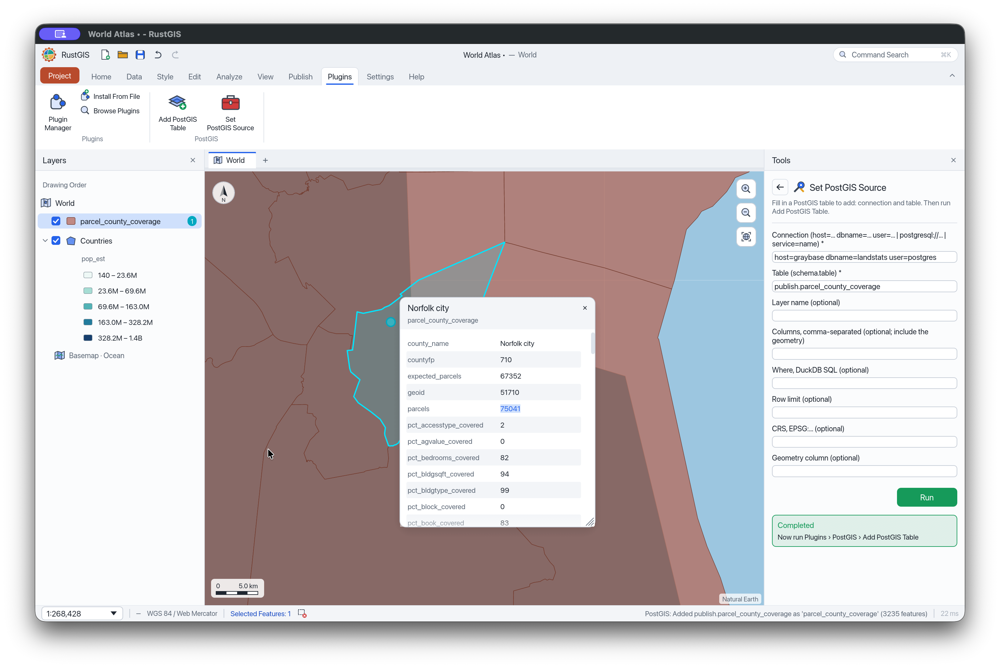

# PostGIS for RustGIS

A [RustGIS](https://rustgis.app) plugin that adds a PostgreSQL/PostGIS table to the map as a
vector layer, with its attribute table, symbology, selection and geoprocessing.

```
plugin:postgis/add-table {"table": "public.counties", "connection": "service=mydb"}
```



> RustGIS's development branch has PostGIS built in (**Home › Add Data › Database…**,
> `layer.addDatabase`), but RustGIS 0.2.0 doesn't. This plugin fills the gap until that
> ships, and it keeps working afterwards.

## In the app

RustGIS runs a plugin's ribbon button without parameters, and a plugin can't open a dialog. So
the plugin takes its input from a small form (a geoprocessing tool) and a table in the project:

1. Click **Plugins › PostGIS › Add PostGIS Table**. The first time, it adds a **PostGIS Sources**
   layer, so the map has a layer for the tool to run on.
2. Open the **Set PostGIS Source** tool (Geoprocessing/Tools pane, under Plugins › PostGIS). Fill
   in the **Connection** (see [Connections](#connections)) and the **Table** as `schema.table`.
   The other boxes are optional (see [Parameters](#parameters)). Click **Run**. This adds a
   one-row "PostGIS Sources (2)" layer.
3. Click **Add PostGIS Table** again. It reads the newest Sources layer and adds its table as a
   layer. If a Sources layer has several rows (copy and paste a row in its attribute table),
   it adds each filled-in row, or only the selected ones.

The Sources layers are saved with the project, so they double as a list of saved connections.
Don't put passwords in them.

You can also ask the **AI Assistant** ("add the PostGIS table public.roads from service=mydb"). It
runs the command with parameters, after asking you. From a script or terminal, pass the
[parameters](#parameters) directly (see [Examples](#examples)).

RustGIS waits for the query to finish when a plugin runs it, so the window doesn't respond while
a large table loads. Use `columns`, `where` or `limit` to read less.

## How it works

RustGIS plugins are sandboxed WebAssembly modules with no network access of their own, and RustGIS
has no PostgreSQL driver. RustGIS can, however, add the result of a DuckDB query as a layer
(`layer.addSql`, which runs the `duckdb` program). This plugin builds that query for you. It
reads the table through DuckDB's [postgres extension](https://duckdb.org/docs/stable/core_extensions/postgres):

```sql
SELECT * FROM postgres_scan('service=mydb', 'public', 'counties')
```

DuckDB reads PostGIS `geometry` columns as DuckDB geometries, and RustGIS caches the result as
GeoParquet. Large results stream like any large GeoParquet file. The extension pushes `columns` and
simple `where` conditions down to PostgreSQL.

## Requirements

- RustGIS 0.2.0 or later.
- **DuckDB 1.5 or later**, as the `duckdb` program on the `PATH` (or in the folder named by
  `RUSTGIS_DUCKDB_BIN`): `brew install duckdb` / `brew upgrade duckdb`. RustGIS needs it for any
  SQL layer. DuckDB downloads its `postgres` and `spatial` extensions the first time.
- Permissions: `edit` (to add the layer) and `files` + `network` (RustGIS requires both before a
  plugin may run a DuckDB query, since a query can read files and web addresses).

## Install

```sh
./build.sh          # builds pkg/ (a plugin folder) and dist/postgis-0.1.0.rgplugin
```

- **Install the package:** Plugins › Plugin Manager › Settings › install
  `dist/postgis-0.1.0.rgplugin` (or drop it on the window), or
  `rustgis-cli plugins install dist/postgis-0.1.0.rgplugin`.
- **While developing:** Plugins › Plugin Manager › Settings › Add Plugin Folder… › `pkg/`.

## Connections

`connection` is anything libpq accepts:

| Form | Example |
| --- | --- |
| Key/value | `host=db.example.com dbname=gis user=postgres` |
| URI | `postgresql://postgres@db.example.com:5432/gis` |
| Service | `service=mydb` (from `~/.pg_service.conf`) |
| Omitted | libpq's defaults: `PGHOST`, `PGDATABASE`, `PGUSER`, … |

**Keep passwords out of the connection string.** The connection string is part of the query, and
RustGIS passes the query to `duckdb` on its command line, where other processes can see it. It
also saves the query in the project file when the layer streams (more than 100,000 features).
The plugin warns you when a connection holds a password. Put passwords in `~/.pgpass`, or use
a service:

```ini
# ~/.pg_service.conf
[mydb]
host=db.example.com
port=5432
dbname=gis
user=postgres
```

```
# ~/.pgpass  (chmod 600)
db.example.com:5432:gis:postgres:secret
```

The desktop app doesn't see your shell's `PG*` variables when it is started from Finder, so the
service file is the most dependable choice there.

## Troubleshooting

| Message | Fix |
| --- | --- |
| `SQL queries and DuckDB databases need DuckDB` | RustGIS can't find `duckdb`. Install DuckDB 1.5+ (`brew install duckdb`). An app started from Finder or the Dock doesn't have your shell's `PATH`, so also run `launchctl setenv RUSTGIS_DUCKDB_BIN /opt/homebrew/bin` and restart RustGIS. Or start RustGIS from a terminal. |
| `i/o: No such file or directory` | An older DuckDB (before 1.5) is running the query. Run `duckdb --version` and upgrade it. |
| `Unable to connect to Postgres … No route to host` | The database is reachable from your terminal but not from the app: on macOS, allow RustGIS under System Settings › Privacy & Security › Local Network, then restart it. |
| `Unable to connect to Postgres` (other) | Check `host`, `dbname` and `user`, and that the password is in `~/.pgpass` or a service. |
| `Table … does not contain any columns` | There is no such table, or the user can't read it. |
| `the query returns no geometry column` | The table has no geometry column, or `columns` left it out. |
| `Fill in a row of 'PostGIS Sources'` | The newest Sources layer has no `table`. Run **Set PostGIS Source** and fill in the Table box. |

## Parameters

| Parameter | Meaning |
| --- | --- |
| `table` | `schema.table`, or `table` for `public.table`. Without it, the command works from the PostGIS Sources table ([In the app](#in-the-app)). Unquoted names are lower-cased as in PostgreSQL; quote names that aren't (`"Survey"."Plots 2024"`). |
| `connection` | See [Connections](#connections). |
| `name` | The layer name (default: the table name). |
| `columns` | The columns to read, as a list or comma-separated text (default: all of them). Include the geometry. |
| `geometry` | The geometry column to draw when the table has more than one (default: the first). |
| `where` | A condition in DuckDB SQL on the table's columns, such as `statefp = '13'`. |
| `limit` | At most this many rows. |
| `crs` | `EPSG:…` for a geometry column without an SRID in its type (plain `geometry`) whose data isn't longitude/latitude. A typed column (`geometry(Polygon, 2274)`) is reprojected without it, and `crs` overrides its SRID. |
| `zoom` | Zoom to the new layer (default `true`). |

## Examples

```sh
# All of a table
rustgis-cli run --plugin ./pkg \
  --cmd 'plugin:postgis/add-table={"table": "public.counties", "connection": "service=mydb"}' \
  --cmd 'share.exportMap={"path": "coverage.png"}'

# Some columns of some rows, styled by a field
rustgis-cli run --plugin ./pkg \
  --cmd 'plugin:postgis/add-table={"table": "public.counties", "connection": "service=mydb",
         "columns": ["geoid", "name", "pop_2020", "geom"], "where": "statefp = '\''13'\''", "name": "Georgia"}' \
  --cmd 'layer.symbology={"layer": "Georgia", "type": "graduated", "field": "pop_2020"}'
```

## Development

You need Rust with the WebAssembly target: `rustup target add wasm32-unknown-unknown`.

```sh
cargo test       # the query builder, on the host
./build.sh       # the WebAssembly module and package
./e2e.sh         # runs it in rustgis-cli against a real database and writes e2e.png
                 # (RUSTGIS_CLI=…, RUSTGIS_DUCKDB_BIN=… if they aren't on the PATH)
```

---

Supported by [Landrecords](https://landrecords.us).
